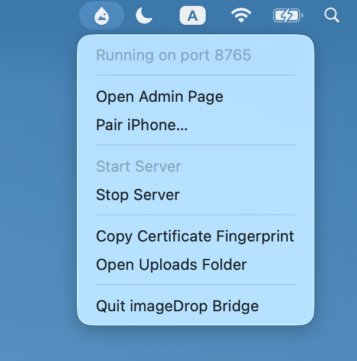
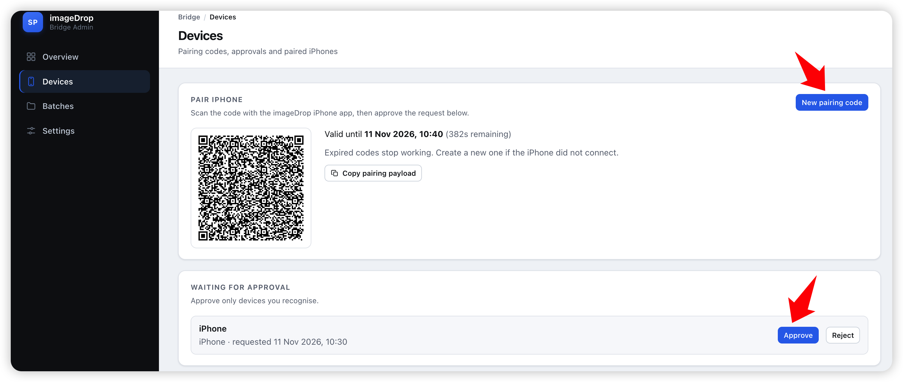

# imageDrop Support

Welcome to imageDrop Support!

imageDrop makes it easy to scan documents, capture photos, and transfer images and files from your iPhone to your Mac.

If you need help setting up imageDrop or troubleshooting a transfer, you'll find the information you need below.

## Getting Started

### 1. Install imageDrop on your iPhone

Download imageDrop from the Apple App Store and open the application.

### 2. Install imageDrop Bridge on your Mac

Install and launch imageDrop Bridge on your Mac. It runs in the macOS menu bar and provides the connection service for receiving files.

### 3. Pair your iPhone with your Mac

1. Open imageDrop Bridge from the macOS menu bar.
2. Select **Pair iPhone**.
3. Follow the pairing instructions displayed by the application.
4. Complete the pairing process on your iPhone.

### 4. Start transferring files

Once paired, you can use imageDrop on your iPhone to scan documents, capture photos, and transfer supported files to your Mac.

## Frequently Asked Questions

### What is imageDrop Bridge?

imageDrop Bridge is the macOS companion application. It runs in the menu bar and allows your iPhone to connect to your Mac and transfer files.

### Do I need to install imageDrop Bridge?

Yes. The macOS companion application is required to receive files on your Mac.

### How do I pair my iPhone with my Mac?

Open imageDrop Bridge from the macOS menu bar and select **Pair iPhone**. Follow the instructions shown on both devices.

### Why can't my iPhone connect to my Mac?

Please check the following:

- Make sure imageDrop Bridge is running on your Mac.
- Make sure the server is started in imageDrop Bridge.
- Make sure your iPhone and Mac can communicate over the network.
- Check whether your firewall or network security settings are blocking the connection.
- Try restarting imageDrop Bridge and pairing again.

### Where are my transferred files stored?

Transferred files are saved in the uploads folder configured by imageDrop Bridge. You can select **Open Uploads Folder** from its menu to access the folder.

### Is an internet connection required?

The connection requirements depend on your network configuration. For local network transfers, your iPhone and Mac need to be able to communicate with each other.

## Troubleshooting

If you experience problems:

1. Restart imageDrop on your iPhone.
2. Restart imageDrop Bridge on your Mac.
3. Make sure the imageDrop Bridge server is running.
4. Verify that your devices can communicate over the network.
5. Try pairing your devices again if necessary.

If the problem persists, contact our support team.

## Contact Support

Need additional help? We would be happy to hear from you.

**Email:** [YOUR SUPPORT EMAIL]

When contacting support, please include:

- Your iPhone model and iOS version.
- Your Mac model and macOS version.
- The version of imageDrop and imageDrop Bridge.
- A description of the issue.
- Screenshots or error messages, if available.

## About imageDrop

imageDrop is designed to make transferring documents, photos, and files between your iPhone and Mac simple and convenient.

Thank you for using imageDrop!

---

© 2026 imageDrop. All rights reserved.
